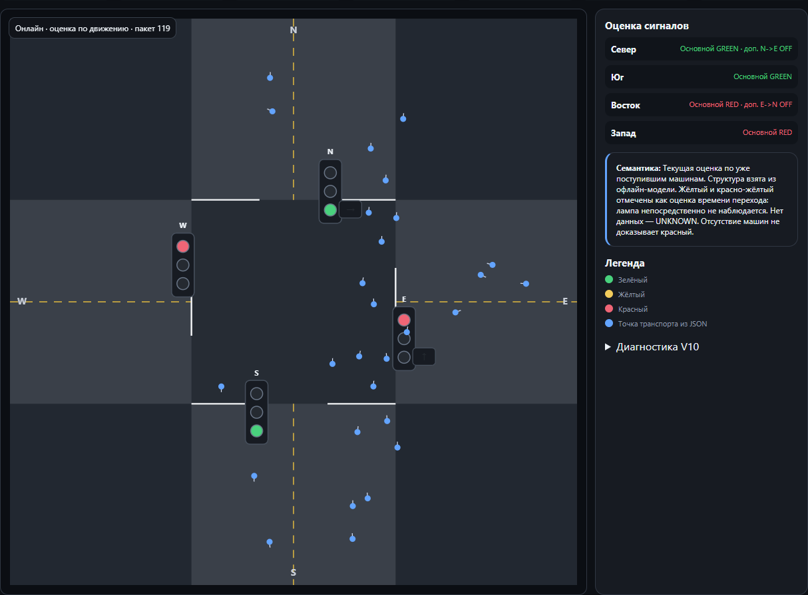
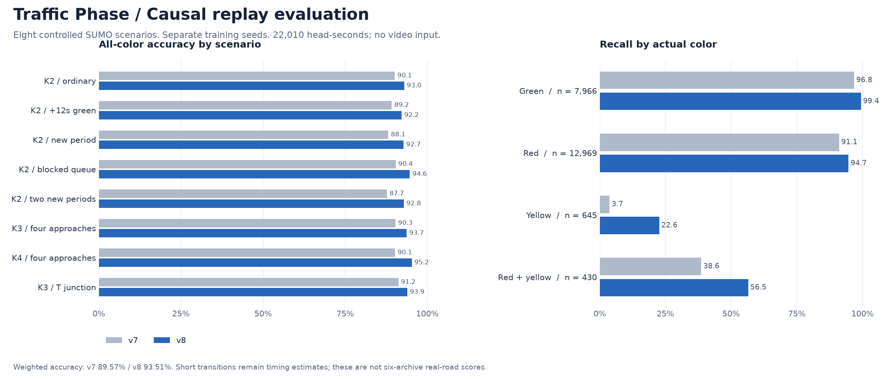

# Traffic Phase

**English** · [Русский](README.ru.md)

[](https://github.com/lisovcoff/traffic_phase/actions/workflows/tests.yml)

Traffic-light phase estimation from vehicle trajectories. Upload a recording of
one intersection, inspect the recovered movement patterns, then follow new
observations in the same player.

The application is written in Python with FastAPI. It discovers the observed
approaches, candidate phases and signal sections from JSON/ZIP recordings.
Video is used to check results; it is never an input to the estimator.



## Run locally

Python 3.12 is the tested environment. On Windows, from the repository root:

```bat
INSTALL.cmd
START_WEB.cmd
```

Open **http://127.0.0.1:8017/visualization**. On Linux or macOS:

```sh
python3.12 -m venv .venv
. .venv/bin/activate
python -m pip install --upgrade "pip>=26.2"
python -m pip install -r requirements-tested-py312.txt
python -m uvicorn app.main:app --host 127.0.0.1 --port 8017
```

Upload an original trajectory JSON or ZIP and click **Анализировать**. After
analysis, choose a recording and use play/pause, speed, the timeline or a precise
time. Each archive should describe one intersection.

For online replay, switch to **Онлайн** on a completed model and choose a JSONL
feed. A second recording can be converted without editing the original:

```sh
python -m scripts.archive_online_packets data/intersection.zip --spool .web_runtime/feed.sqlite3 --output .web_runtime/feed.jsonl
```

Use fresh output paths for each conversion. To connect a detector, send current
observations to the packet endpoint shown in the panel. The [API guide](docs/API.md)
describes the format. A feed manifest or analysis report is not a vehicle input.

Saved models, players and journals live in `logs/intersection_projects/`. Keep
that directory when moving an existing analysis. At startup, `?` means the model
is still synchronizing or has insufficient evidence.

## How it works

Offline analysis separates recordings and sessions, estimates observed geometry,
groups movement permissions and learns recurring phase configurations. Multiple
programs can coexist in the saved model.

Online inference keeps that structure fixed and updates phase, color and timing
from current and past vehicle observations. Queue-front departures, passages,
braking and continued waiting contribute evidence. Competing duration hypotheses
allow a new period or an isolated extension without assuming a perfectly repeated
cycle. Missing traffic alone does not establish a red signal.

The player shows the actual local offline history or the original issued online
estimates. Packet journals and internal checkpoints preserve accepted history
and support restarting a stream. Existing v7 journals remain compatible; new
models with learned queue geometry use v8.

## Measurements

The following benchmark uses **eight controlled SUMO scenarios** with training
seeds separate from replay seeds. All main heads and colors are scored at one-second
resolution. An unknown estimate counts as incorrect. One head-second means one
head evaluated for one second.



| Measurement | v7 | v8 |
|---|---:|---:|
| All-color accuracy, 22,010 head-seconds | 89.57% | **93.51%** |
| Green recall, 7,966 head-seconds | 96.77% | **99.37%** |
| Red recall, 12,969 head-seconds | 91.10% | **94.66%** |
| Yellow recall, 645 head-seconds | 3.72% | **22.64%** |
| Red + yellow recall, 430 head-seconds | 38.60% | **56.51%** |
| False-green head-seconds | 920 | **666** |

Short colors are the weakest part of the model. The overall score is dominated
by red and green; it should not be read as 93.51% accuracy for every color.
Yellow and red + yellow are marked in the player as **timing estimates**.
Their transition times are inferred, not directly observed. The release audit
preserves the existing decoder and its issued colors rather than retuning them
against these already revealed controls.

There are two remaining benchmark regressions: false green during one period
change, and red + yellow on the T junction. The strict no-regression gate remains
failed. The full per-case counts are in the [evaluation report](results/causal_v8.md).

Real-video checks have narrower coverage:

| Check | Result | Scope |
|---|---:|---|
| Visible N green/yellow interiors | 148/153 = **96.73%** | Known window, conditional clock alignment |
| Same input with a +12s green extension | 153/165 = **92.73%** | Counterfactual copy, not an observed emergency |
| Separate green-onset delay | **1.42s**, previously 3.42s | Distance to the conditional clock envelope |

Six real archives from three intersections have been processed, but complete
independent lamp truth is unavailable for all of them. These measurements do
not establish 95% accuracy across all six archives or certify inferred hardware.

The charts and tables were aggregated with pandas from the saved measurement
receipts. Only their outputs are committed; the pandas reporting script stays
local. [Statistics and provenance](results/statistics.json) ·
[Release audit](results/release_audit.md) · [Validation coverage](results/README.md)

## Development

```sh
python -m compileall -q app scripts tests
python -m pytest -q
python -m scripts.e2e_smoke
```

The large regression fixture uses Git LFS: run `git lfs pull` after cloning.
Checks that require private recordings are skipped in a clean clone. The test
suite covers ingestion, inference, temporal boundaries, the API, journal recovery
and the player. Optional SUMO and browser checks are documented in the
[guide](GUIDE.md).

| Directory | Contents |
|---|---|
| `app/core/`, `app/experimental/` | Estimator, recovery code and research implementations |
| `app/api/`, `app/static/` | HTTP endpoints and player assets |
| `scripts/` | CLI tools, simulators and evaluation runners |
| `tests/` | Unit, regression and API tests |
| `docs/`, `results/` | Architecture, contracts, measurements and audit |

Raw recordings, generated players, frames, logs and research runs remain local
and are excluded from Git. `config/` supports explicit legacy diagnostic tools;
the automatic intersection workflow does not select a named site profile.

[Architecture](docs/ARCHITECTURE.md) · [API](docs/API.md) ·
[Guide](GUIDE.md) · [Current status](docs/PROJECT_STATUS.md)
